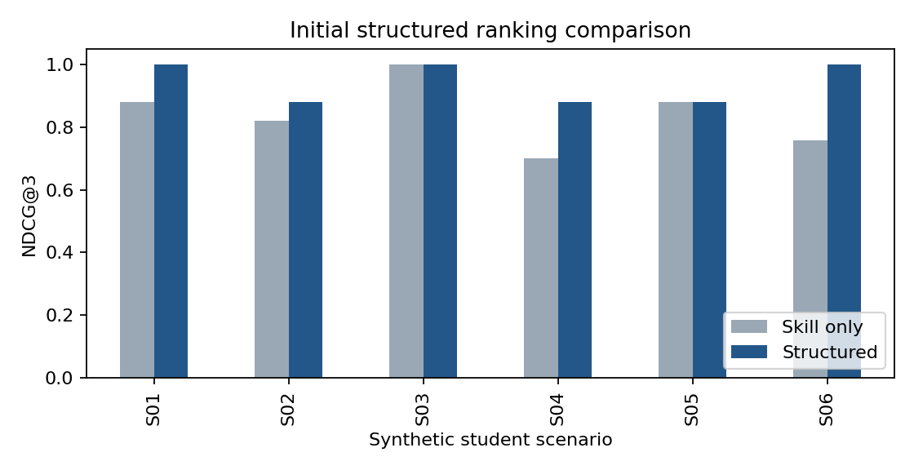

# Method and Baseline

Graduate Career Opportunity Recommender | Mohammed Fardhar Baig

## 1. Computational method implemented

The method ranks fictional career opportunities for each synthetic student profile using structured attributes. Skill coverage is the size of the intersection between profile skills and opportunity-required skills divided by the number of required skills. Skill strings are lowercased, trimmed and deduplicated. Empty required-skill lists are rejected rather than assigned a perfect match.

Academic-field compatibility is 1 if the profile field is listed among accepted fields and 0 otherwise. Opportunity-type and work-mode matches are binary. Their average gives preference compatibility. The combined score is 0.60 x skill coverage + 0.25 x field compatibility + 0.15 x preference compatibility. These fixed soft weights are not calibrated probabilities or learned parameters. Ties are resolved by opportunity ID in ascending order.

The question is whether these additional attributes improve Precision@3 and NDCG@3 compared with skill-only scoring. No embedding model, classifier, collaborative signal or model training is used. Scoring functions receive profile/opportunity attributes, not relevance labels. Labels enter only the evaluation step after rankings are produced.

## 2. Responsible source modules

src/career_methods.py contains normalize, components, structured_score, ordered, precision_at_k, ndcg_at_k and validate_inputs. src/prepare_inputs.py defines the synthetic scenarios and labels. src/run_foundation.py records Week 1 validation. src/run_comparison.py executes Week 2 and saves component scores, rankings and metrics. src/test_career_methods.py contains 14 method tests. src/protocol.json fixes the design. The notebook includes the executed input construction, methods, foundation and comparison code, with a test-run cell and observations. src/build_reports.py regenerates both milestone reports.

## 3. Baseline and evaluation criteria

The reference ranks opportunities using skill coverage alone. It uses the same twelve candidates and tie-break rule as the combined score. Precision@3 treats grades 1 and 2 as relevant and divides the relevant top-three count by 3. NDCG@3 uses gain 2^grade - 1, discount log2(rank + 1), and an ideal ordering derived from all twelve grades for that profile. An all-zero ideal gives NDCG 0. Per-profile values are macro-averaged; candidate pairs are not treated as independent statistical trials.

## 4. Fixed experimental procedure

The frozen diagnostic collection contains six profiles, twelve opportunities and all 72 pair judgments. The same input files are used for both milestones. The rubric and per-pair rationales are available in data/synthetic/relevance.json. Profiles have no missing required attributes; cross-domain overlap in generic skills deliberately creates cases where skill-only matches can be contextually weak.

Weights, K=3, the relevance threshold, gain convention and tie-breaking are declared before the first comparison. The comparison checks all input hashes and the protocol bytes. No labels, candidates or weights were changed after observing metrics. There is no supervised train/test partition because the method fits no model, but the constructed benchmark also is not independent held-out evidence. Later tuning must use separate development scenarios and final evaluation judgments.

## 5. Reproduction instructions

python -m pip install -r src/requirements.txt

python src/prepare_inputs.py

python src/run_foundation.py

python -m unittest discover -s src -p 'test_*.py' -v

python src/run_comparison.py

python src/build_reports.py

Run these separate commands from the repository root. The notebook can instead be opened from the root or src directory and run in order after selecting the environment containing the dependencies. Repeated comparison runs overwrite generated Week 2 evidence without changing the Week 1 output files. Input regeneration is deterministic. No internet data acquisition or API credentials are used.

## 6. Initial experimental results

| Method | Macro Precision@3 | Macro NDCG@3 |
| --- | --- | --- |
| skill_only | 0.833333 | 0.839573 |
| structured | 0.833333 | 0.939481 |

The combined score increases macro NDCG@3 by 0.099908 while leaving macro Precision@3 unchanged. It places high-grade opportunities earlier within these constructed cases, but does not increase the average relevant top-three count. NDCG improves for S01, S02, S04 and S06 and is unchanged for S03 and S05. The Precision@3 improvement for S01 is canceled by a decline for S02.

## Results by scenario and failure analysis

| Scenario | Skill P@3 | Combined P@3 | NDCG change |
| --- | --- | --- | --- |
| S01 | 0.666667 | 1.000000 | +0.121038 |
| S02 | 1.000000 | 0.666667 | +0.057648 |
| S03 | 1.000000 | 1.000000 | +0.000000 |
| S04 | 0.666667 | 0.666667 | +0.178686 |
| S05 | 0.666667 | 0.666667 | +0.000000 |
| S06 | 1.000000 | 1.000000 | +0.242076 |

For S02, the preferred remote software internship O04 moves from rank 2 to rank 1, improving NDCG. However, the combined score introduces O02 at rank 3 despite grade 0 and replaces a grade-1 opportunity; Precision@3 falls from 1.000000 to 0.666667. O02 accepts computer science, but the profile lacks statistics and the intended scenario does not judge the role useful. Broad field acceptance is insufficient to resolve this mismatch.

For S05, finance internship O12 remains rank 3 with grade 0 under both methods. Strong Excel/SQL coverage outweighs its domain and opportunity-type mismatch. A weighted soft score does not enforce every contextual condition. These are retained failure cases, not corrected by post hoc relabeling. Full rankings and score_components.csv make every recommendation traceable.

## 7. Validation performed

All 14 automated method tests passed: skill normalization, partial coverage, a known combined score, half preference compatibility, an empty profile-skill set, rejection of empty opportunity requirements, invalid weight sums, deterministic ties, known Precision@3, perfect/zero/hand-calculated NDCG, invalid K and missing pair coverage. Known-value tests check the formulas independently of the observed experiment.

All nine foundation checks and thirteen Week 2 input/numerical checks passed. Additional Week 2 checks include finite bounded scores, two complete rankings per profile, unchanged grades and unchanged protocol bytes. Same-input repeated execution produced byte-identical ranking, score and metric CSVs. results/week_2/repeatability.json records their hashes. Repeated execution verifies deterministic computation; it is not an independent experimental sample.

## 8. Methodological problems and unresolved questions

The main limitation is measurement validity: author-defined grades share conceptual assumptions with the method. They are fixed before scoring but are not independent judgments, and favorable results could reflect the scenario design. Six profiles and twelve opportunities do not represent the graduate labor market. Generic skill overlap, binary fields and soft preferences simplify professional fit.

The higher average NDCG does not establish real student utility, placement success, fairness or current vacancy relevance. There is no statistical superiority claim. Cross-domain failures show that a hard-constraint policy may be worth testing, but no constraint revisions or weight search are implemented in this milestone. Future development must separate rule selection from final evaluation.

Next priorities are additional varied scenarios, independent judgments where feasible, a separate development/evaluation design before tuning, and systematic inspection of hard versus soft compatibility. These are Week 3 plans. The present milestone demonstrates an executable method and initial evidence, not completed research.

## Evidence provenance and literature context

Executed Python 3.12.14; numpy 2.3.5, pandas 2.2.3, matplotlib 3.10.8. Inputs, score components, complete rankings, per-profile and macro metrics, validation logs and repeatability hashes are included. Exact environment and protocol hashes are recorded in execution_summary.json. Both milestone stages were prepared now; no earlier work or commit dates are implied.

Kaya, M., & Bogers, T. (2026). Analyzing the Effects of a Human-in-the-Loop Candidate Recommendation Algorithm at Jobindex. ACM Transactions on Recommender Systems. https://doi.org/10.1145/3801092 . This is selected reading about recruiter-facing candidate recommendations, not an algorithm or result reproduced here.

de Ruijt, C., & Bhulai, S. (2021). Job Recommender Systems: A Review. https://arxiv.org/abs/2111.13576 . Jarvelin, K., & Kekalainen, J. (2002). Cumulated gain-based evaluation of IR techniques. ACM TOIS, 20(4), 422-446. https://doi.org/10.1145/582415.582418 . The supplied bibliography is retained under docs/references/.
